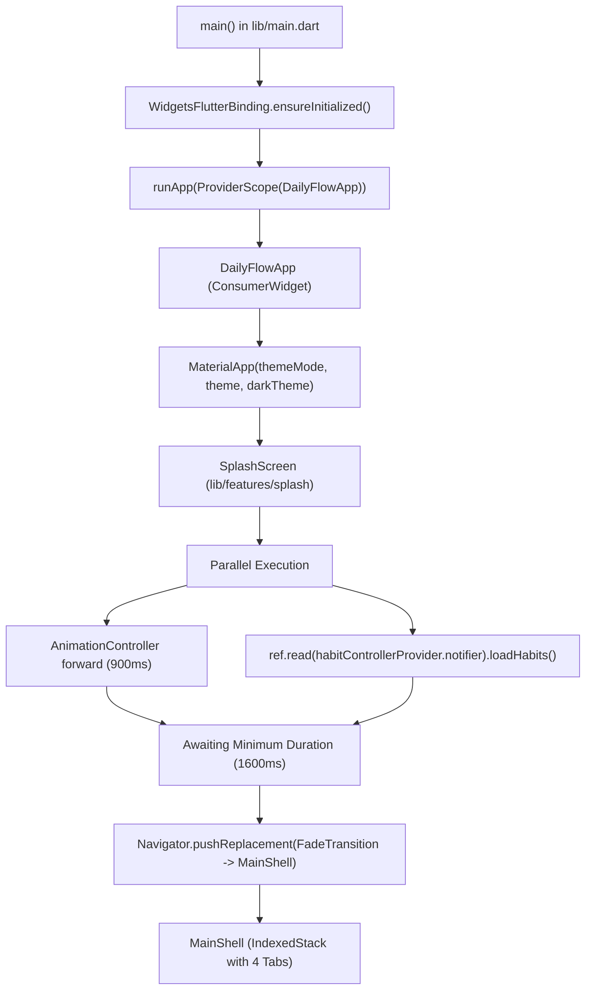
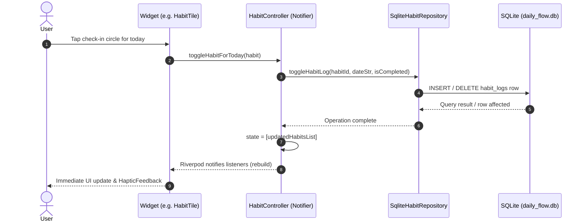
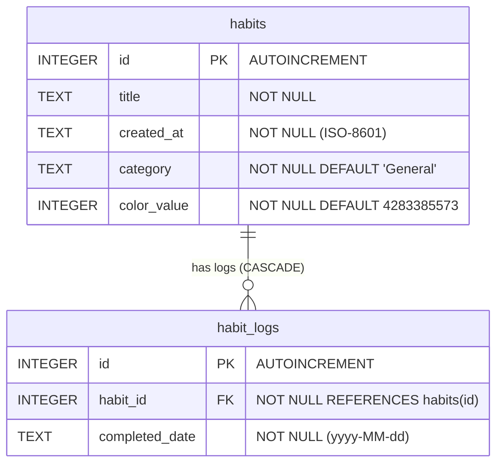

# Architectural Analysis: DailyFlow

This document analyzes the structural patterns, data flow, component hierarchies, and maintainability of the **DailyFlow** codebase.

---

## 1. Directory & File Structure

The project adheres to a hybrid feature-first and layered domain architecture under `lib/`:

```text
lib/
├── core/
│   ├── constants/
│   │   └── app_constants.dart          # Centralized categories, focus presets, color palettes
│   ├── database/
│   │   └── db_helper.dart              # SQLite database initialization, table creation & migrations
│   ├── theme/
│   │   ├── app_theme.dart              # Light & Dark Material 3 theme configurations
│   │   └── theme_provider.dart         # ThemeModeNotifier (Riverpod) for managing theme state
│   └── utils/
│       └── date_utils.dart             # Date formatting, streak calculation, heatmap & weekday rates
├── features/
│   ├── analytics/
│   │   └── screen/
│   │       └── stats_screen.dart       # Insights & Analytics dashboard (KPI cards, heatmap, bar chart)
│   ├── focus/
│   │   └── screen/
│   │       └── focus_screen.dart       # Pomodoro timer linked to habits
│   ├── habits/
│   │   ├── controllers/
│   │   │   └── habit_controller.dart   # HabitController (Riverpod Notifier)
│   │   ├── data/
│   │   │   └── habit_repository.dart   # HabitRepository interface & SqliteHabitRepository
│   │   ├── models/
│   │   │   └── habit.dart              # Habit domain model
│   │   └── screen/
│   │       ├── habit_detail_screen.dart# Individual habit streak view & monthly calendar
│   │       ├── home_screen.dart        # Main habit list, category filter chips & actions
│   │       ├── focus_screen.dart       # [DEPRECATED / SHIM] Re-exports ../../focus/screen/focus_screen.dart
│   │       ├── stats_screen.dart       # [DEPRECATED / SHIM] Re-exports ../../analytics/screen/stats_screen.dart
│   │       ├── main_shell.dart         # [DEPRECATED / SHIM] Re-exports ../../navigation/screen/main_shell.dart
│   │       └── widgets/
│   │           ├── habit_form_dialog.dart    # Add/Edit habit modal dialog
│   │           ├── habit_tile.dart           # Interactive habit card with 7-day strip
│   │           └── weekly_overview_card.dart # 7-day completion progress card
│   ├── navigation/
│   │   └── screen/
│   │       └── main_shell.dart         # 4-tab IndexedStack shell with Material 3 NavigationBar
│   ├── profile/
│   │   └── screen/
│   │       └── profile_screen.dart     # User profile, achievement badges & category breakdown
│   ├── settings/
│   │   └── screen/
│   │       └── settings_screen.dart    # Settings view (theme selector, haptics, reminder picker)
│   └── splash/
│       └── screen/
│           └── splash_screen.dart      # Animated branded splash screen & async preloader
└── main.dart                           # Application entrypoint & ProviderScope root
```

### Architectural Observations:
- **Clean Feature Decoupling**: High-level features (`analytics`, `focus`, `navigation`, `profile`, `settings`, `splash`, `habits`) are segregated into dedicated feature folders.
- **Legacy Export Shims**: Inside `lib/features/habits/screen/`, three stub files exist:
  - `focus_screen.dart` (`export '../../focus/screen/focus_screen.dart';`)
  - `stats_screen.dart` (`export '../../analytics/screen/stats_screen.dart';`)
  - `main_shell.dart` (`export '../../navigation/screen/main_shell.dart';`)
  *Assessment*: These were retained for backward compatibility after modularizing the codebase. They should be phased out and their import sites updated directly.

---

## 2. Application Entry Points & Lifecycle



1. **`lib/main.dart`**:
   - Calls `WidgetsFlutterBinding.ensureInitialized()`.
   - Wraps the root widget in a `ProviderScope` to enable Riverpod dependency injection throughout the widget tree.
   - Instantiates `DailyFlowApp`, which observes `themeModeProvider` to switch dynamically between `ThemeMode.light`, `ThemeMode.dark`, and `ThemeMode.system`.
2. **`SplashScreen`**:
   - Acts as the initial visual route.
   - Runs a scale and fade-in animation (`900ms`) while simultaneously invoking `loadHabits()` to pre-warm the SQLite database.
   - Enforces a minimum splash screen duration (`1600ms`) to avoid flickering before smoothly transitioning into `MainShell`.
3. **`MainShell`**:
   - Manages the primary navigation state using `IndexedStack` to keep `HomeScreen`, `StatsScreen`, `FocusScreen`, and `ProfileScreen` resident in memory without rebuilding on tab changes.

---

## 3. Data Flow & State Management

The application implements a unidirectional data flow following the **Repository Pattern** with Riverpod:



### Key Components & Responsibilities:

1. **`Habit` Domain Model (`lib/features/habits/models/habit.dart`)**:
   - Completely immutable Dart entity.
   - Owns computed logic for `currentStreak`, `bestStreak`, and `totalCompletions` by delegating math to `AppDateUtils`.
2. **`HabitRepository` (`lib/features/habits/data/habit_repository.dart`)**:
   - Defines the abstract contract for data operations: `getHabits()`, `createHabit()`, `updateHabit()`, `deleteHabit()`, `toggleHabitLog()`, and `restoreHabit()`.
   - `SqliteHabitRepository` implements this contract using raw SQL queries and transactions via `sqflite`.
3. **`HabitController` (`lib/features/habits/controllers/habit_controller.dart`)**:
   - Subclasses Riverpod's `Notifier<List<Habit>>`.
   - Orchestrates repository calls and produces new immutable state snapshots (`List<Habit>`).
   - Ensures local state remains synchronized with SQLite records.

---

## 4. Database Architecture & ER Diagram

The database utilizes SQLite v2 managed through `DBHelper` (`lib/core/database/db_helper.dart`).



### Table Specifications:

1. **`habits`**:
   - `id`: Auto-incrementing primary integer key.
   - `title`: String description of the habit.
   - `created_at`: ISO timestamp string representing creation time.
   - `category`: Text categorization (`General`, `Health`, `Study`, `Coding`, `Fitness`).
   - `color_value`: 32-bit ARGB integer defining the custom accent color.

2. **`habit_logs`**:
   - `id`: Auto-incrementing primary integer key.
   - `habit_id`: Foreign key referencing `habits(id)`.
   - `completed_date`: Normalized string (`yyyy-MM-dd`).
   - `UNIQUE(habit_id, completed_date)`: Ensures idempotent check-ins for any specific habit on any date.

### Migration Architecture:
- `DBHelper._initDB` opens the database with `version: 2`.
- When an existing v1 database is detected (`oldVersion < 2`), `_onUpgrade` executes non-destructive `ALTER TABLE` statements:
  ```sql
  ALTER TABLE habits ADD COLUMN category TEXT NOT NULL DEFAULT 'General';
  ALTER TABLE habits ADD COLUMN color_value INTEGER NOT NULL DEFAULT 4283385573;
  ```

### Critical Database Finding: Foreign Key Pragma Gap
- SQLite defaults to having foreign key enforcement **disabled**.
- In `DBHelper.dart`, `openDatabase` does not define an `onConfigure` callback to execute `PRAGMA foreign_keys = ON;`.
- *Implication*: While the DDL specifies `ON DELETE CASCADE`, SQLite will not enforce cascading deletion unless the PRAGMA is explicitly turned on upon connection establishment. Currently, `SqliteHabitRepository.deleteHabit` manually deletes from `habit_logs`, but direct deletes or external SQLite tools could leave orphaned logs.

---

## 5. Reusable UI Components

The application demonstrates strong UI modularity with distinct, self-contained widgets:

| Component | Path | Function | Reusability |
| :--- | :--- | :--- | :--- |
| **`HabitTile`** | `lib/features/habits/screen/widgets/habit_tile.dart` | Habit display with swipe-to-delete, streak badge, and interactive 7-day mini-strip. | High |
| **`WeeklyOverviewCard`** | `lib/features/habits/screen/widgets/weekly_overview_card.dart` | Animated linear completion bar and percentage card. | High |
| **`HabitFormDialog`** | `lib/features/habits/screen/widgets/habit_form_dialog.dart` | Reusable modal dialog for creating and editing habits. | High |
| **`_DetailStatCard`** | `lib/features/habits/screen/habit_detail_screen.dart` | Micro-stat card displaying icons, labels, and formatted values. | Medium (Private) |
| **`_KpiCard`** | `lib/features/analytics/screen/stats_screen.dart` | Analytical KPI tile for total check-ins, active habits, and streak. | Medium (Private) |
| **`_HeatmapGrid`** | `lib/features/analytics/screen/stats_screen.dart` | Responsive 12-week (84-day) intensity matrix. | Medium (Private) |
| **`_WeekdayBarChart`** | `lib/features/analytics/screen/stats_screen.dart` | Custom animated vertical bar chart for weekday performance. | Medium (Private) |

*Recommendation*: Promote private widgets (`_KpiCard`, `_DetailStatCard`) into a shared `core/widgets/` design library to prevent code duplication across detail, analytics, and profile screens.

---

## 6. Code Organization & Maintainability Assessment

### Strengths:
1. **Separation of Concerns**: State management (`controllers`), data persistence (`data`), models (`models`), and views (`screen`, `widgets`) are clearly partitioned.
2. **Deterministic Domain Logic**: Date utilities, streak logic, and heatmap calculations are extracted into `AppDateUtils` (`lib/core/utils/date_utils.dart`), making them 100% testable without Flutter UI dependencies.
3. **Repository Abstraction**: `HabitRepository` is an interface, allowing `SqliteHabitRepository` to be easily mocked or replaced with an in-memory/mock repository during testing (as demonstrated in `test/widget_test.dart`).

### Weaknesses / Technical Debt:
1. **Unpersisted App Settings**: Settings and theme state are disconnected from SQLite or shared preferences, degrading UX across restarts.
2. **Missing Async State Handling**: `HabitController` maintains a raw `List<Habit>` rather than `AsyncValue<List<Habit>>`. Initial loading states cannot be represented cleanly in UI listeners without artificial splash delays.
3. **Unused / Legacy Export Files**: Deprecated export wrappers remain in `lib/features/habits/screen/`.
4. **Hardcoded Domain Values**: User profile data, categories, and colors are hardcoded rather than dynamically managed.
