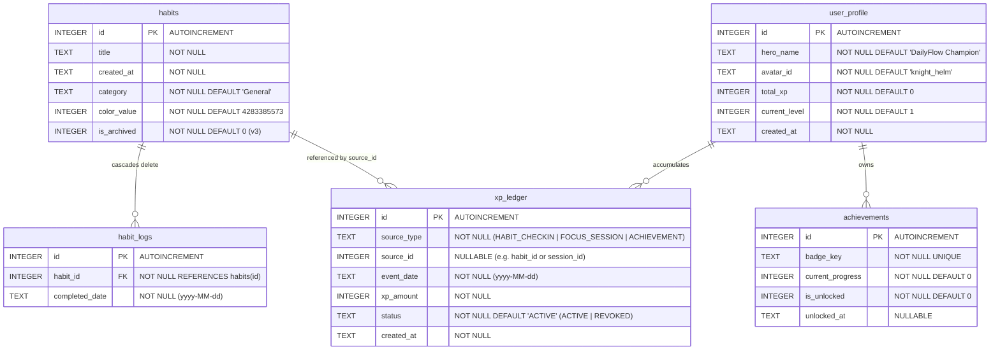

# Database Migration & Persistence Plan: DailyFlow SQLite v3

**Target Schema Version:** `version: 3`  
**Core Objective:** Introduce persistent gamification entities (XP Ledger, User Profile, Achievements) while strictly preserving 100% of existing user habits, completion logs, and streak history.

---

## 1. Zero Data-Loss Guarantee

1. **Non-Destructive Alterations**: Existing `habits` and `habit_logs` tables will not be dropped or modified destructively.
2. **Deterministic Historical Backfill**: Existing users upgrading to v3 will **not** start at Level 1 with 0 XP. A one-time atomic migration will calculate historical XP from all past records in `habit_logs` and credit the player with their rightful level and unlocked badges.
3. **Transaction Safety**: All schema modifications and data backfill queries will execute inside a single SQLite transaction `db.transaction(...)`. If any error occurs, the database automatically rolls back to its exact v2 state.

---

## 2. Target Database Schema (v3)



---

## 3. SQLite DDL Specifications

### 3.1 New Tables

#### `xp_ledger`
```sql
CREATE TABLE IF NOT EXISTS xp_ledger (
    id INTEGER PRIMARY KEY AUTOINCREMENT,
    source_type TEXT NOT NULL,
    source_id INTEGER,
    event_date TEXT NOT NULL,
    xp_amount INTEGER NOT NULL,
    status TEXT NOT NULL DEFAULT 'ACTIVE',
    created_at TEXT NOT NULL,
    UNIQUE(source_type, source_id, event_date)
);
CREATE INDEX IF NOT EXISTS idx_xp_ledger_date ON xp_ledger(event_date);
CREATE INDEX IF NOT EXISTS idx_xp_ledger_status ON xp_ledger(status);
```

#### `user_profile`
```sql
CREATE TABLE IF NOT EXISTS user_profile (
    id INTEGER PRIMARY KEY AUTOINCREMENT,
    hero_name TEXT NOT NULL DEFAULT 'DailyFlow Champion',
    avatar_id TEXT NOT NULL DEFAULT 'knight_helm',
    total_xp INTEGER NOT NULL DEFAULT 0,
    current_level INTEGER NOT NULL DEFAULT 1,
    created_at TEXT NOT NULL
);
```

#### `achievements`
```sql
CREATE TABLE IF NOT EXISTS achievements (
    id INTEGER PRIMARY KEY AUTOINCREMENT,
    badge_key TEXT NOT NULL UNIQUE,
    current_progress INTEGER NOT NULL DEFAULT 0,
    is_unlocked INTEGER NOT NULL DEFAULT 0,
    unlocked_at TEXT
);
```

### 3.2 Additions to `habits`
```sql
ALTER TABLE habits ADD COLUMN is_archived INTEGER NOT NULL DEFAULT 0;
```

---

## 4. Migration Execution Plan (`onUpgrade` in `DBHelper`)

### Step 1: Enable Foreign Keys PRAGMA
Update `openDatabase` in `lib/core/database/db_helper.dart` to add the critical `onConfigure` handler:
```dart
onConfigure: (db) async {
  await db.execute('PRAGMA foreign_keys = ON;');
},
```

### Step 2: v2 to v3 Upgrade Script
```dart
Future<void> _onUpgrade(Database db, int oldVersion, int newVersion) async {
  if (oldVersion < 2) {
    await db.execute(
      "ALTER TABLE habits ADD COLUMN category TEXT NOT NULL DEFAULT 'General'",
    );
    await db.execute(
      "ALTER TABLE habits ADD COLUMN color_value INTEGER NOT NULL DEFAULT 4283385573",
    );
  }

  if (oldVersion < 3) {
    await db.transaction((txn) async {
      // 1. Add optional archive column to habits
      await txn.execute(
        "ALTER TABLE habits ADD COLUMN is_archived INTEGER NOT NULL DEFAULT 0",
      );

      // 2. Create xp_ledger table
      await txn.execute('''
        CREATE TABLE IF NOT EXISTS xp_ledger (
          id INTEGER PRIMARY KEY AUTOINCREMENT,
          source_type TEXT NOT NULL,
          source_id INTEGER,
          event_date TEXT NOT NULL,
          xp_amount INTEGER NOT NULL,
          status TEXT NOT NULL DEFAULT 'ACTIVE',
          created_at TEXT NOT NULL,
          UNIQUE(source_type, source_id, event_date)
        )
      ''');
      await txn.execute(
        'CREATE INDEX IF NOT EXISTS idx_xp_ledger_date ON xp_ledger(event_date)',
      );

      // 3. Create user_profile table
      await txn.execute('''
        CREATE TABLE IF NOT EXISTS user_profile (
          id INTEGER PRIMARY KEY AUTOINCREMENT,
          hero_name TEXT NOT NULL DEFAULT 'DailyFlow Champion',
          avatar_id TEXT NOT NULL DEFAULT 'knight_helm',
          total_xp INTEGER NOT NULL DEFAULT 0,
          current_level INTEGER NOT NULL DEFAULT 1,
          created_at TEXT NOT NULL
        )
      ''');

      // 4. Create achievements table
      await txn.execute('''
        CREATE TABLE IF NOT EXISTS achievements (
          id INTEGER PRIMARY KEY AUTOINCREMENT,
          badge_key TEXT NOT NULL UNIQUE,
          current_progress INTEGER NOT NULL DEFAULT 0,
          is_unlocked INTEGER NOT NULL DEFAULT 0,
          unlocked_at TEXT
        )
      ''');

      // 5. Backfill historical XP from existing habit_logs
      final existingLogs = await txn.rawQuery('''
        SELECT habit_id, completed_date FROM habit_logs ORDER BY completed_date ASC
      ''');

      int backfillXp = 0;
      final nowStr = DateTime.now().toIso8601String();

      for (final row in existingLogs) {
        final habitId = row['habit_id'] as int;
        final date = row['completed_date'] as String;
        const checkinXp = 20;

        await txn.insert(
          'xp_ledger',
          {
            'source_type': 'HABIT_CHECKIN',
            'source_id': habitId,
            'event_date': date,
            'xp_amount': checkinXp,
            'status': 'ACTIVE',
            'created_at': nowStr,
          },
          conflictAlgorithm: ConflictAlgorithm.ignore,
        );
        backfillXp += checkinXp;
      }

      // Calculate starting level using formula: L = floor((XP / 100)^(1 / 1.4)) + 1
      int startingLevel = 1;
      if (backfillXp > 0) {
        startingLevel = (pow(backfillXp / 100.0, 1.0 / 1.4)).floor() + 1;
      }

      // 6. Insert initial User Profile record
      await txn.insert('user_profile', {
        'hero_name': 'DailyFlow Champion',
        'avatar_id': 'knight_helm',
        'total_xp': backfillXp,
        'current_level': startingLevel,
        'created_at': nowStr,
      });
    });
  }
}
```

---

## 5. Rollback & Disaster Recovery Procedures

1. **Pre-flight Integrity Check**: Before running `_onUpgrade`, check that `sqlite_master` contains valid `habits` and `habit_logs` tables.
2. **Transaction Atomicity**: If any SQL query in the upgrade block throws an error, the SQLite transaction aborts and leaves the database file at version 2 with zero changes written.
3. **Graceful Degraded Mode**: If `xp_ledger` fails to load, `HabitRepository` falls back to calculating streaks and habit logs independently, ensuring core habit tracking is never blocked.
