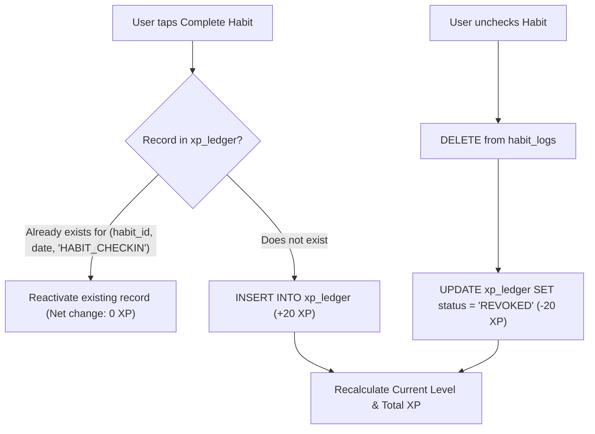

# Gamification Specification: DailyFlow

This specification defines the mathematical models, quest structures, leveling progression, anti-farming integrity rules, and achievement systems for **DailyFlow**.

---

## 1. Player Leveling & Experience Points (XP)

### 1.1 Leveling Curve Formula

The progression system is calibrated to provide immediate positive reinforcement in the first 7 days (early game dopamine), transitioning into a steady, long-term mastery curve.

```text
Level Formula:
XP Required for Level L = 100 * (L - 1)^1.4

Inverse Formula (Calculate Level from Total XP):
Level = floor( (Total XP / 100)^(1 / 1.4) ) + 1
```

#### Level Progression Milestones:

| Level | Title / Rank | Cumulative XP Required | XP from Previous Level | Typical Timeframe |
| :---: | :--- | :---: | :---: | :--- |
| **1** | Novice Wanderer | 0 XP | 0 XP | Day 1 |
| **2** | Habit Initiate | 100 XP | 100 XP | Day 2 |
| **3** | Routine Apprentice | 264 XP | 164 XP | Day 4 |
| **4** | Focus Journeyman | 466 XP | 202 XP | Day 7 (End of Week 1) |
| **5** | Flow Adept | 701 XP | 235 XP | Day 11 |
| **10** | Consistency Knight | 2,298 XP | 387 XP | Month 1 |
| **20** | Master of Will | 6,839 XP | 609 XP | Month 3 |
| **30** | Grand Flow Archon | 12,654 XP | 802 XP | Month 6 |
| **50** | Legendary Champion | 27,243 XP | 1,146 XP | Year 1 |

---

## 2. Quests & Reward Economics

Habits are presented to the user as **Daily Quests**.

### 2.1 XP Reward Matrix

| Activity | Base XP | Bonus / Multiplier | Cap / Limits |
| :--- | :---: | :--- | :--- |
| **Daily Quest Check-in** | `+20 XP` | Streak Bonus (up to +15 XP) | Once per habit per calendar date |
| **Full Daily Clean Sheet** | `+50 XP` | Bonus if ALL active habits completed today | Once per calendar day |
| **Pomodoro Focus Session** | `+1 XP / min` | 25 min = `+25 XP`, 60 min = `+60 XP` | Max 180 XP / day (prevents timer abuse) |
| **Streak Milestone (7 Days)** | `+100 XP` | One-time claim upon reaching milestone | Per habit milestone |
| **Streak Milestone (30 Days)**| `+500 XP` | One-time claim upon reaching milestone | Per habit milestone |
| **Streak Milestone (100 Days)**| `+1,500 XP`| One-time claim upon reaching milestone | Per habit milestone |
| **Achievement Unlock** | `+50 to +250 XP` | Defined per badge tier | Once per achievement |

### 2.2 Streak XP Multiplier (Momentum Bonus)

To incentivize consecutive consistency without causing hyper-inflation:

$$\text{Streak Bonus} = \min(15, \text{currentStreak} \times 2) \text{ XP}$$

- Day 1: +20 Base + 0 = **20 XP**
- Day 3: +20 Base + 6 = **26 XP**
- Day 7+: +20 Base + 14 = **34 XP**
- Day 8+: +20 Base + 15 (Cap) = **35 XP**

---

## 3. Anti-Farming & Deterministic Ledger Architecture

### The Farming Vulnerability
In naïve gamified apps, checking a habit grants +20 XP. If a user unchecks and re-checks the habit 50 times in a row, they gain 1,000 XP in 30 seconds.

### The Solution: Event-Deduplicated XP Ledger
DailyFlow utilizes a **Deterministic XP Ledger** (`xp_ledger` table in SQLite) combined with an **Idempotent State Calculator**.



### 3.1 Idempotency Rules:
1. **Source of Truth**: Every XP point in the app is backed by a specific ledger entry identified by a composite unique key:
   - `source_type`: `HABIT_CHECKIN` | `FOCUS_SESSION` | `ACHIEVEMENT` | `CLEAN_SHEET`
   - `source_id`: The ID of the habit, session, or achievement.
   - `event_date`: The calendar date (`yyyy-MM-dd`).
2. **Re-toggling Defense**:
   - If a habit is unchecked: Its corresponding check-in XP entry status is marked as `REVOKED` (or deleted), removing the XP from the player's total.
   - If the habit is re-checked on the same day: The ledger reactivates the original record. The user **cannot** receive duplicate XP for the same habit on the same day.
3. **Backdated Toggling**:
   - Toggling a completion date on the 7-day strip or monthly calendar creates an XP entry stamped with that `event_date`.
   - The total XP and level are recalculated deterministically:
     $$\text{Total XP} = \sum \text{xp\_amount} \quad \text{where status} = \text{'ACTIVE'}$$
4. **Habit Deletion & Cascading**:
   - If a habit is deleted, its ledger entries can either be archived or revoked based on user preference. The recommended default is **Legacy Honor**: XP earned from past completed days remains in the ledger as historic mastery, but future checks are disabled.

---

## 4. Quests Structure

```text
┌────────────────────────────────────────────────────────────────────────┐
│                        DAILY QUEST TIERS                               │
├────────────────────────────────────────────────────────────────────────┤
│  1. Common Quests:    Individual daily habits (e.g. "Drink 2L Water")  │
│  2. Daily Bounty:     Complete 3 quests before noon (+25 XP)           │
│  3. Daily Conquest:   Clean sheet — 100% of habits checked today (+50) │
│  4. Focus Trial:      Complete at least one 25-min Pomodoro (+25 XP)   │
└────────────────────────────────────────────────────────────────────────┘
```

Habits are decorated with RPG quest cards:
- **Quest Rank Badge**: Based on streak (Bronze for 1–6 days, Silver for 7–29 days, Gold for 30–99 days, Mythic for 100+ days).
- **Quest Reward Indicator**: Pill chip showing `+20 XP` or `+35 XP (Streak Active)`.

---

## 5. Achievements & Badge Tree

Achievements are organized into thematic progression paths:

### 5.1 The Warrior’s Path (Streaks)
1. **First Spark**: Complete your first habit check-in (+50 XP).
2. **Flame Keeper**: Maintain any habit for a 7-day streak (+100 XP).
3. **Iron Will**: Maintain any habit for a 30-day streak (+250 XP).
4. **Centurion of Routine**: Maintain any habit for 100 consecutive days (+1,000 XP).

### 5.2 The Scholar’s Path (Focus & Mind)
1. **Single Spark**: Complete your first 15-minute Focus session (+50 XP).
2. **Deep Delver**: Accumulate 5 hours of total Focus time (+150 XP).
3. **Arcane Master**: Complete a 60-minute Focus trial without pausing (+200 XP).

### 5.3 The Architect’s Path (Breadth & Mastery)
1. **Guild Founder**: Create 3 different habits across distinct categories (+50 XP).
2. **Polymath**: Create habits covering all 5 core categories (+150 XP).
3. **Flawless Victory**: Complete all active habits in a single day (+100 XP).
4. **Chronicle of Seasons**: Record 500 total check-ins all-time (+500 XP).

---

## 6. Real-Time Celebrations & Reduced-Motion Adaptations

1. **Level-Up Modal**:
   - Appears when `newLevel > previousLevel`.
   - Displays animated crest, rank title upgrade, and unlocked bonuses.
   - Dismissible via tap with smooth exit.
2. **Reduced Motion Adaptation**:
   - If user has OS reduced motion enabled, particles and bounce scales are disabled.
   - Celebration is replaced with a refined, static victory card with a soft golden border glow and standard fade-in.
